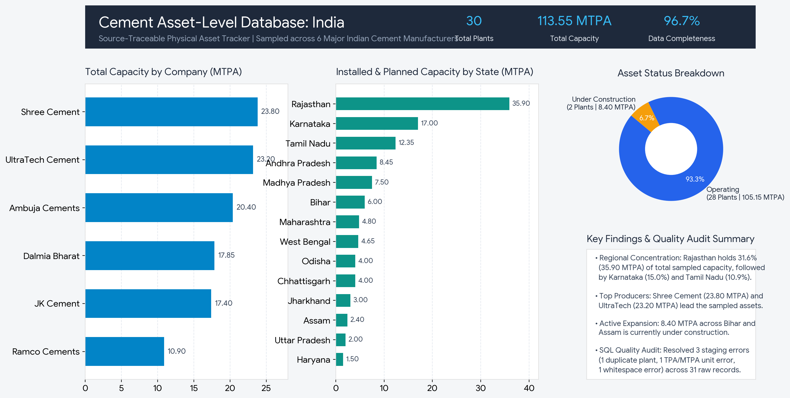

# Asset-Level Cement Plant Database (India)

## Objective
Build a structured, source-traceable database of physical cement plant assets (location, capacity, status, commissioning year) for major Indian cement manufacturers, validate data integrity with SQL quality checks, and visualize findings in a dashboard.

## Scope
- **Sector:** Cement Manufacturing, India
- **Companies (6):** UltraTech Cement, Shree Cement, Dalmia Bharat, JK Cement, Ramco Cements, Ambuja Cements
- **Records:** 30 verified plant assets (cleaned from 31 raw staging records)
- **Total Sampled Capacity:** 113.55 MTPA

## Data Sources
Company websites (manufacturing facility disclosures), integrated annual reports (FY2024-25), stock exchange filings (BSE/NSE), investor presentations, and sustainability/BRSR reports. Every record includes a document citation and page/URL for full audit traceability.

## Method
1. Collected physical asset attributes into `assets_raw.csv` using standardized guidelines (capacity normalized to MTPA, `NA` where unpublished, zero unverified estimates).
2. Loaded raw records into MySQL via a text-based staging table (`assets_raw` in `schema.sql`).
3. Executed 9 SQL data quality checks (`quality_checks.sql`) covering duplicate facilities, missing mandatory fields, invalid categories, unit/capacity outliers, trailing spaces, and completeness rates.
4. Resolved staging errors and populated normalized relational tables (`companies` and `assets`) yields 30 clean records (`assets_cleaned.csv`).
5. Built an executive summary view (`dashboard.png` / Power BI).

## Data Quality Results
- **Duplicates found and removed:** 1 (`A029` duplicate entry for UltraTech's Dhar Cement Works)
- **Unit / capacity errors fixed:** 1 (`A030` Shree Cement's Panipat Grinding Unit recorded in TPA `1,500,000` instead of `1.50` MTPA)
- **Formatting / whitespace issues resolved:** 1 (`A031` trailing whitespace in `Dalmia Bharat `)
- **Missing values marked `NA`:** 1 (`A028` commissioning year for under-construction Warisaliganj Grinding Unit)
- **Overall Data Completeness:** **96.7%** (29 of 30 records contain complete capacity, location, and commissioning year data)

## Dashboard

## Key Findings
- **Regional Concentration:** **Rajasthan** holds **31.6% (35.90 MTPA)** of the total sampled capacity across 7 plants, followed by **Karnataka (15.0% | 17.00 MTPA)** and **Tamil Nadu (10.9% | 12.35 MTPA)**.
- **Company Breakdown:** **Shree Cement (23.80 MTPA)** and **UltraTech Cement (23.20 MTPA)** account for the highest sampled capacity, followed by **Ambuja Cements (20.40 MTPA)** and **Dalmia Bharat (17.85 MTPA)**.
- **Operating vs. Pipeline:** **92.6% (105.15 MTPA across 28 plants)** of capacity is currently operating, while **7.4% (8.40 MTPA across 2 plants in Bihar and Assam)** is under construction.

## Tools Used
Excel/CSV, MySQL, Power BI, Python, GitHub

## Data Dictionary & Entry Guidelines
| Field | Rule |
|---|---|
| `Asset_ID` | Unique identifier (`A001` to `A030`) |
| `Plant_Type` | `Integrated`, `Grinding Unit`, or `Clinker Unit` |
| `Capacity_MTPA` | Million tonnes per annum (convert TPA by dividing by 1,000,000) |
| `Status` | `Operating` or `Under Construction` |
| `Year_Commissioned` | 4-digit commissioning year, or `NA` if unpublished |
| `Source_Document` | Official report or filing title |
| `Source_Page_or_URL` | Page number or direct source URL |
| `Collected_Date` | `YYYY-MM-DD` |
